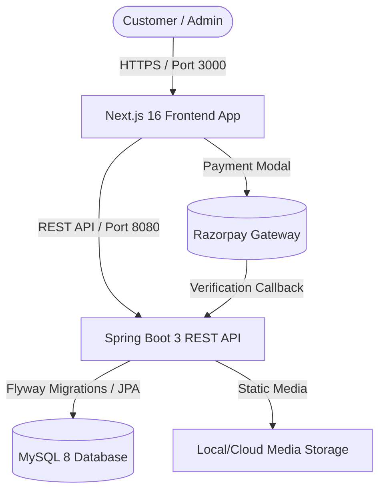

# 🌿 Pragati Nursery — Full-Stack E-Commerce Platform

A production-ready, full-stack e-commerce web platform for **Pragati Nursery**, specializing in plants, gardening supplies, pots, seeds, and fertilizers. Built with a modern decoupled architecture featuring a **Next.js 16** frontend and a robust **Spring Boot 3** backend with **MySQL 8**.

---

## 📑 Table of Contents

- [Overview](#-overview)
- [Key Features](#-key-features)
- [Tech Stack](#-tech-stack)
- [System Architecture](#-system-architecture)
- [Directory Structure](#-directory-structure)
- [Quick Start](#-quick-start)
  - [Prerequisites](#prerequisites)
  - [Option A: Docker Compose (Recommended)](#option-a-docker-compose-recommended)
  - [Option B: Manual Local Setup](#option-b-manual-local-setup)
- [Environment Variables](#-environment-variables)
- [Default Credentials & Seeding](#-default-credentials--seeding)
- [Key API Endpoints](#-key-api-endpoints)
- [Payment Gateway Integration](#-payment-gateway-integration)
- [Bilingual Support](#-bilingual-support)
- [Testing & Quality Assurance](#-testing--quality-assurance)

---

## 🌟 Overview

Pragati Nursery delivers a seamless plant shopping experience with:
- **Instant Guest Checkout**: Customers can order plants in seconds without mandatory registration.
- **Order Tracking via OTP**: Secure phone-based verification for order history.
- **Bilingual Interface**: Full English and Marathi support for rural and urban plant lovers alike.
- **Secure Payments**: Integrated Razorpay gateway and Cash on Delivery (COD).
- **Admin Dashboard**: Real-time management for catalog, stock, pincodes, delivery charges, and orders.

---

## ✨ Key Features

### 🛒 Customer Experience
- **Interactive Catalog**: Filter by category, price, sunlight requirement, water needs, and search terms.
- **Bilingual Content**: Switch dynamically between English and Marathi (`मराठी`).
- **Pincode Delivery Check**: Real-time validation of delivery availability and automated shipping fees.
- **Guest & User Checkout**: Seamless checkout flow storing shipping snapshots with each order.
- **Wishlist & Cart**: Persistent cart synchronized across sessions and local storage.
- **Order History & Tracking**: Instant lookup using phone number and one-time password (OTP).

### 🛡️ Admin Portal
- **Dashboard Metrics**: Orders, gross sales, inventory alerts, and customer insights.
- **Product & Category Management**: Bilingual product creation, image uploading, pricing, stock levels, and care instructions.
- **Order Processing**: Live order status transitions (`PENDING`, `CONFIRMED`, `SHIPPED`, `DELIVERED`, `CANCELLED`).
- **Business Settings**: Configurable delivery fees, free delivery thresholds, banner alerts, and contact details.

---

## 🛠 Tech Stack

| Layer | Technologies |
| :--- | :--- |
| **Frontend** | Next.js 16 (App Router), React 19, TypeScript, Tailwind CSS v4, shadcn/ui, Lucide Icons |
| **Backend** | Java 21, Spring Boot 3.2.3, Spring Data JPA, Hibernate, Spring Security 6 |
| **Database** | MySQL 8.0, Flyway Database Migrations |
| **Security** | Stateless JWT in HTTP-Only secure cookies, BCrypt, CORS filters |
| **Payments** | Razorpay Node/Java SDK, HMAC-SHA256 signature verification |
| **DevOps** | Docker, Docker Compose, Maven, PostCSS |

---

## 🏗 System Architecture



---

## 📁 Directory Structure

```text
Pragati-Nursery/
├── Backend/                         # Spring Boot 3 REST API
│   ├── src/main/java/com/pragatinursery/
│   │   ├── account/                 # User shipping/billing addresses
│   │   ├── auth/                    # JWT authentication & user accounts
│   │   ├── catalog/                 # Products, categories, care guides
│   │   ├── common/                  # Global exceptions, SMS service, file storage
│   │   ├── config/                  # WebMvc, CORS, DataInitializer seeder
│   │   ├── customer/                # Customer entity & order linkage
│   │   ├── order/                   # Orders, order items, OTP verification
│   │   ├── payment/                 # Razorpay order generation & verification
│   │   ├── pincode/                 # Pincode serviceability & delivery fee rules
│   │   └── security/                # JWT filters, cookies, and Spring Security
│   ├── src/main/resources/
│   │   ├── db/migration/            # Flyway SQL migration scripts (V1 through V16)
│   │   └── application.yml          # Spring Boot configuration
│   ├── Dockerfile                   # Backend Docker build
│   └── pom.xml                      # Maven dependencies
│
├── Frontend/                        # Next.js 16 Web Application
│   ├── app/                         # App Router (Pages & Layouts)
│   │   ├── admin/                   # Admin portal (Products, Orders, Customers)
│   │   ├── cart/                    # Cart overview page
│   │   ├── checkout/                # Checkout & Razorpay payment page
│   │   ├── shop/                    # Category catalog & filter pages
│   │   ├── your-orders/             # Phone OTP order tracking
│   │   └── layout.tsx               # Root layout & providers
│   ├── components/                  # Reusable React components
│   ├── lib/                         # Language translations, API client, local storage
│   ├── services/                    # API integration layer
│   ├── types/                       # TypeScript interfaces
│   └── package.json                 # Next.js & React dependencies
│
├── docker-compose.yml               # Multi-container orchestration (MySQL + Backend)
├── .env.example                     # Environment template
└── PROJECT_SUMMARY.md               # Detailed architecture summary
```

---

## 🚀 Quick Start

### Prerequisites
- **Node.js**: v18.18+ or v20+
- **JDK**: Java 21 LTS
- **Maven**: 3.8+
- **MySQL**: 8.0+ (or Docker)
- **Docker & Docker Compose** (Optional, recommended)

---

### Option A: Docker Compose (Recommended)

1. **Clone the repository and copy environment variables:**
   ```bash
   cp .env.example .env
   ```
2. **Configure your `.env`** with your credentials:
   ```env
   MYSQL_ROOT_PASSWORD=your_root_password
   MYSQL_PASSWORD=your_mysql_password
   JWT_SECRET=404E635266556A586E3272357538782F413F4428472B4B6250645367566B5970
   RAZORPAY_KEY_ID=rzp_test_your_key_id
   RAZORPAY_KEY_SECRET=your_key_secret
   ```
3. **Launch Database and Backend:**
   ```bash
   docker compose up --build -d
   ```
4. **Run Frontend locally:**
   ```bash
   cd Frontend
   npm install
   npm run dev
   ```
5. Open your browser at **`http://localhost:3000`**.

---

### Option B: Manual Local Setup

#### 1. Setup Database
```sql
CREATE DATABASE IF NOT EXISTS pragati_nursery;
```

#### 2. Run Backend
```bash
cd Backend

# Verify environment variables or application.yml
mvn clean package -DskipTests
mvn spring-boot:run
```
*Backend runs on `http://localhost:8080`.*

#### 3. Run Frontend
```bash
cd Frontend
npm install
npm run dev
```
*Frontend runs on `http://localhost:3000`.*

---

## 🔑 Default Credentials & Seeding

On first startup, Flyway executes schema migrations, and `DataInitializer` populates default seed data if the database is empty:

| Role | Email / Identifier | Password | Access |
| :--- | :--- | :--- | :--- |
| **Admin** | `admin@pragatinursery.in` | `admin123` | `/admin` dashboard |
| **Demo Customer** | Any valid phone number | Mock OTP `123456` *(in dev)* | `/your-orders` |

---

## 📡 Key API Endpoints

### 🌿 Public Catalog
- `GET /api/v1/categories` — Fetch all active categories
- `GET /api/v1/products` — Filter products by category, price, and query
- `GET /api/v1/products/{idOrSlug}` — Product details with specs and care instructions
- `GET /api/v1/pincodes/check/{pincode}` — Verify delivery availability and calculate shipping fee

### 🛍️ Orders & Guest Checkout
- `POST /api/v1/orders` — Create new order (supports registered & guest users)
- `GET /api/v1/orders/number/{orderNumber}` — Retrieve order summary by order number
- `POST /api/v1/orders/history/send-otp` — Send OTP to customer's mobile number
- `POST /api/v1/orders/history/verify-otp` — Verify OTP and fetch order history

### 💳 Payments
- `POST /api/v1/payments/create-order` — Create Razorpay order with INR amount
- `POST /api/v1/payments/verify` — Validate HMAC-SHA256 signature and confirm order payment

### 🛠️ Admin Management (`/api/v1/admin/*`)
- `GET /api/v1/admin/dashboard/stats` — Revenue, order count, and low stock warnings
- `POST /api/v1/admin/products` — Create new product with bilingual metadata
- `PUT /api/v1/admin/orders/{id}/status` — Update order fulfillment status
- `GET /api/v1/admin/settings` — Get delivery charge rules and business information

---

## 🌐 Bilingual Support

Pragati Nursery natively supports **English** and **Marathi**:
- **Products & Categories**: Column storage for `name_mr`, `description_mr`, and `care_guide_mr`.
- **UI Components**: Seamless instant translation switching via `Frontend/lib/language.tsx`.
- **Policy Pages**: Pre-translated terms, shipping, cancellation, and privacy policies.

---

## 🧪 Testing & Quality Assurance

- **Backend Unit & Integration Tests**:
  ```bash
  cd Backend
  mvn test
  ```
- **Load & Diagnostic Testing**:
  ```bash
  cd load-test
  npm install
  npm test
  ```

---

## 📄 License

This project is proprietary and developed for **Pragati Nursery**. All rights reserved.